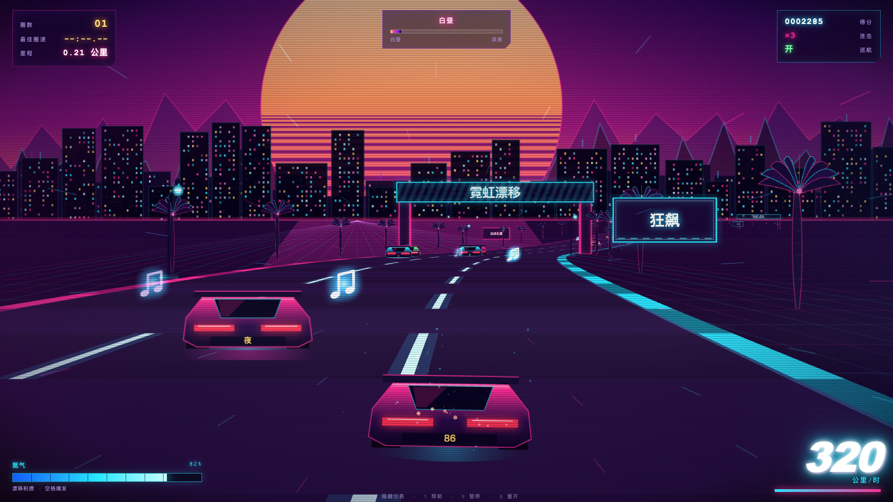
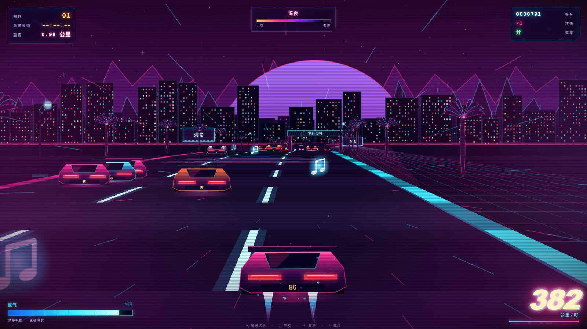
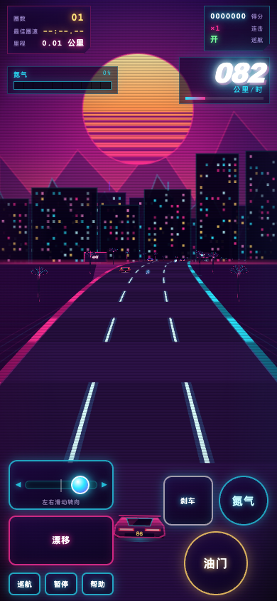

# 霓虹漂移 // 狂飙 1986

**NEON DRIFT // OUTRUN 1986** — 一款 80 年代合成器浪潮（Synthwave / Outrun）风格的网页版赛车游戏。

**▶ 在线试玩：<https://mousejl.github.io/neon-drift/>**

零外部素材、零第三方依赖、零构建步骤 —— 打开 `index.html` 即可游玩，所有画面由 Canvas 代码绘制，所有音乐音效由 Web Audio API 实时合成。



## 特性

- **OutRun 式伪 3D 路面**：分段投影渲染（非平面贴图），粉青双色路缘、发光车道线
- **完整场景层次**：条纹落日、星空、远山剪影、三层亮窗城市天际线、棕榈树 / 路灯 / 霓虹广告牌 / 跨路拱门
- **昼夜循环**：跑完一圈，落日完成一次由昼入夜的过渡（HUD 实时显示时段进度条）
- **CRT 质感**：扫描线、暗角、噪点滤镜
- **QQ 飞车式玩法**：漂移积攒氮气 → 氮气爆发冲刺 → 超车连击倍率加分
- **补充元素**：发光音符拾取补氮气、加速带、最佳圈速（BEST LAP）记录、无终点无尽模式（视野内始终有车可超）
- **实时合成音频**：112 BPM synthwave BGM（和弦走向 Am7-Fmaj7-Cmaj7-G，鼓组 / 贝斯 / 16 分音符琶音 / Pad / Lead，挂 delay + 卷积混响）；引擎声随车速实时变调；点击「启动引擎」后才会发声（符合浏览器自动播放策略）
- **移动端适配**：触屏虚拟按键（油门 / 刹车 / 氮气 / 漂移）+ 左右滑动模拟量转向，界面自适应竖屏 / 横屏与刘海安全区



## 操作

### 键盘

| 按键 | 功能 |
|---|---|
| `W` / `↑` | 油门 |
| `S` / `↓` | 刹车 |
| `A` `D` / `←` `→` | 左右转向 |
| `Shift` | 漂移（积攒氮气） |
| `空格` | 氮气爆发 |
| `C` | 自动巡航开关 |
| `P` | 暂停 / 继续 |
| `R` | 重新开始 |
| `H` | 隐藏 / 显示仪表（方便录屏） |
| `?` | 游戏内帮助面板 |

### 触屏

- **左右滑动转向**：左下角滑动条上按住拖动，或屏幕左半区空白处直接滑动；滑得越远转向越大，松手自动回正
- **油门 / 刹车 / 氮气 / 漂移**：右下与左下按钮，支持多指同时操作

## 调试参数

在 URL 后追加参数，可组合使用（例如 `index.html?night=1&pos=0.35&auto=1`）：

| 参数 | 效果 |
|---|---|
| `?auto=1` | 开局自动巡航 |
| `?night=1` | 夜色开局 |
| `?pos=0.35` | 跳转至 35% 处的弯道路段 |



## 本地运行

无需安装任何东西：

```bash
# 直接双击 index.html，或
open index.html          # macOS
# 或起个本地服务器
python3 -m http.server   # 访问 http://localhost:8000
```

## 项目结构

```
index.html            页面结构：Canvas、仪表 HUD、启动/暂停/帮助面板、触屏按钮
css/style.css         霓虹视觉样式、CRT 滤镜、移动端布局与安全区适配
js/scene.js           场景渲染：伪 3D 投影、天空/城市/山体/精灵绘制与缓存
js/game.js            赛道生成、车辆物理、漂移/氮气/连击、圈速、输入、主循环
js/audio.js           Web Audio 实时合成：BGM 音序器、引擎声、音效
preview/              实机截图（日间 / 夜色 / 手机竖屏 / 手机横屏）
开发提示词整理.md      本项目从立项到中文化的全部需求记录
```

## 技术要点

- **伪 3D 渲染**：赛道由 1500 个分段组成，按相机深度逐段投影，弯道由多条正弦叠加生成
- **性能**：棕榈树 / 路灯 / 广告牌 / 拱门等精灵全部预渲染进离屏 Canvas 缓存，运行时仅做贴图变换
- **音频**：单一 `AudioContext` 调度整个音序器（ lookahead 调度模式），混响用程序生成的脉冲响应卷积，无任何音频文件
- **兼容**：使用经典 `<script>` 标签加载（非 ES Module），保证 `file://` 协议直接打开可运行

## 相关链接

- 开发记录：[开发提示词整理.md](开发提示词整理.md)
- Gitee 镜像（私有）：<https://gitee.com/mousejl/neon-drift>

---

*漂移积攒氮气 · 超车连击加分 · 拾取音符补给 · 一圈即是一次日落到深夜*
